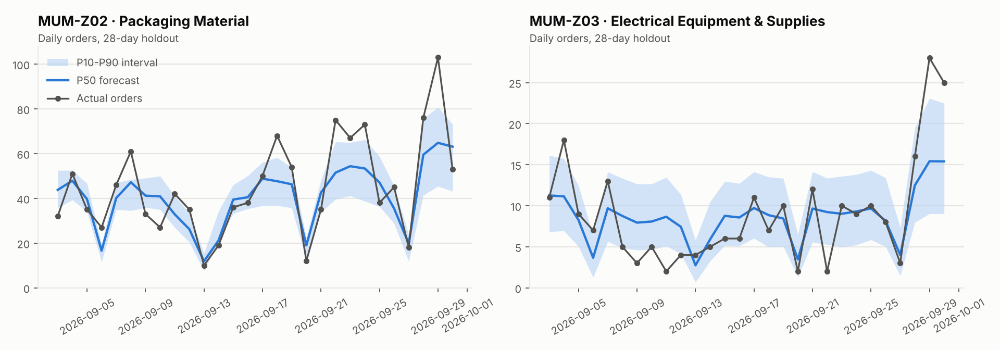
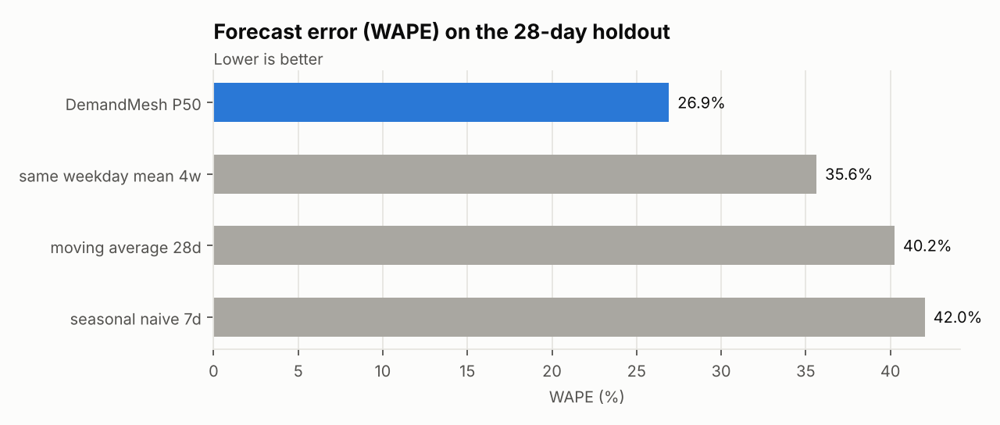
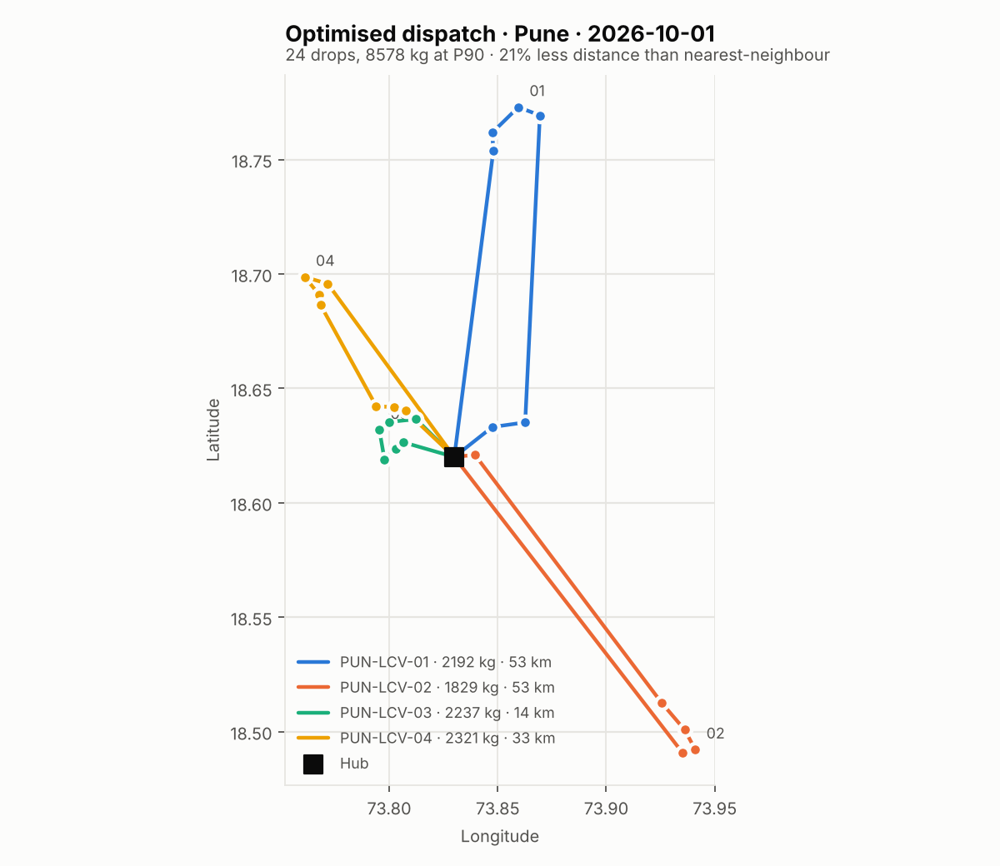
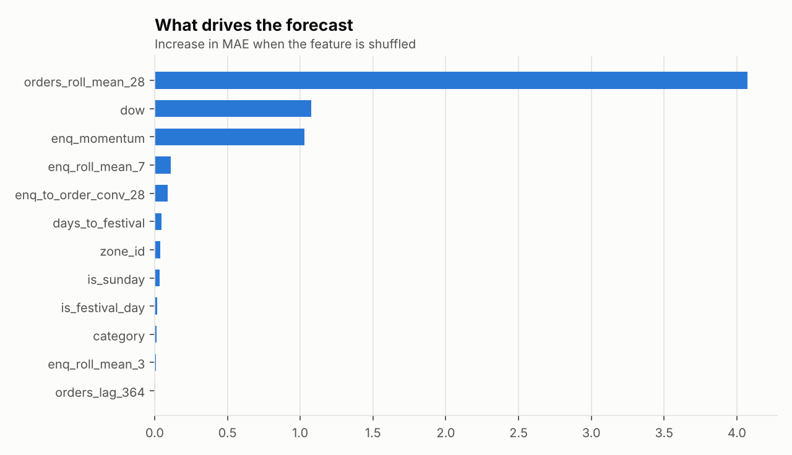
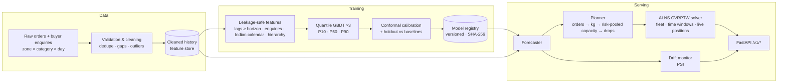

# DemandMesh

**Hyper-local B2B demand forecasting and dynamic route optimisation for India's industrial clusters.**


DemandMesh forecasts tomorrow's B2B orders for every industrial zone × product category
(Okhla electricals, Surat textiles, Ludhiana machinery, ...), turns the forecast into freight
weight, books the right number of trucks, and builds time-window-feasible delivery routes -
re-planning mid-day when a truck is delayed or new orders arrive.

> **Data note.** Real marketplace data is proprietary, so the repo ships with a simulator
> that reproduces the structure such data has (enquiry → order lag, Diwali ramp-up, Sunday
> shutdown, fiscal-year-end push, monsoon effects, cluster specialisation, dirty records).
> Every number below comes from that synthetic data and proves the method end-to-end -
> it is not a claim about any real company.

---

## The business problem

On a B2B marketplace, buyers post enquiries (RFQs) and suppliers in industrial clusters
ship part-truck consignments. Transport is typically booked reactively, the day it is
needed. Two costs follow:

| Pain | Root cause | What DemandMesh does |
|---|---|---|
| Trucks booked at spot rates, late pickups | No view of tomorrow's freight per cluster | 7-day P10/P50/P90 forecast per zone × category |
| Half-empty trucks, long routes | Each consignment dispatched on its own | Capacity booked with risk pooling, routes optimised with ALNS |
| Plans break by noon | Static plans, no re-optimisation | Solver starts each truck from its *current* position and time |

## Results (synthetic data, 28-day holdout, 2026-09-03 → 2026-09-30)

**Forecasting** - 240 series, 8 cities, 3 years of daily data, 7-day-ahead features.

| Method | WAPE | Bias |
|---|---|---|
| **DemandMesh P50** | **26.9 %** | −3.8 % |
| Same-weekday mean (4 weeks) | 35.6 % | −2.0 % |
| 28-day moving average | 40.2 % | −2.2 % |
| Seasonal naive (last week) | 42.0 % | −1.0 % |

* **24.5 % lower error** than the best baseline. Error falls to **12.2 % at zone-day** and
  **6.4 % at city-day** level, which is where trucks are actually booked.
* **Calibrated uncertainty:** P10–P90 intervals cover **79.6 %** of actuals (nominal 80 %)
  after conformal calibration (77.9 % raw).

**Capacity booking** - how many trucks to book per city-day:

| Book capacity at | City-days short of trucks | Unplanned freight | Idle capacity |
|---|---|---|---|
| Sum of P50s | 63.4 % | 5.5 % | 2.1 % |
| Sum of P90s (naive) | 0.0 % | 0.0 % | 50.0 % |
| **Risk-pooled P90 (used)** | **14.7 %** | **0.9 %** | **9.8 %** |

Quantiles do not add up: summing category P90s books half again the trucks needed.
Pooling the uncertainty cuts idle capacity from 50 % to 9.8 % while 99 % of freight is still pre-booked.

**Routing** - next-day plans for all 8 cities vs. a time-window-aware nearest-neighbour dispatcher:
**15.5 % less distance and 7.4 % lower cost** network-wide (1,134 km vs 1,342 km; ₹66,989 vs
₹72,379 per day), range 1.6 %–37.5 % distance saved per city, zero unserved drops.
Full tables: [`reports/metrics.md`](reports/metrics.md).

| Forecast vs actual | Model vs baselines |
|---|---|
|  |  |
| **Optimised dispatch (Pune)** | **Drivers of the forecast** |
|  |  |

---

## Architecture



| Layer | Module | Highlights |
|---|---|---|
| Simulation | `data_generator.py` | Enquiries lead orders by ~8 days; festivals, monsoon, fiscal year; injected defects |
| Cleaning | `data_preprocessing.py` | Schema checks, last-write-wins dedupe, causal gap imputation, robust IQR capping |
| Features | `data_preprocessing.py` | One function for training **and** serving; every target-derived feature shifted ≥ horizon |
| Calendar | `calendar_india.py` | Diwali, Navratri, Dussehra, Holi, Eid, Ganesh Chaturthi, national holidays, March FY-end |
| Model | `model_training.py` | Quantile `HistGradientBoostingRegressor` per quantile, scale-free target, time-ordered early stopping |
| Uncertainty | `model_training.py` | Conformalized Quantile Regression (Romano et al., 2019) |
| Routing | `route_optimizer.py` | ALNS (Ropke & Pisinger, 2006): 4 destroy + 2 repair operators, adaptive weights, simulated annealing |
| Planning | `planner.py` | Category weights, logistics attach rate, risk-pooled P90, drop splitting, baseline comparison |
| Monitoring | `drift.py` | Population Stability Index against the last 180 training days |
| API | `app.py`, `schemas.py` | Pydantic v2 contracts, typed errors, request ids, liveness/readiness probes |

## Quickstart

```bash
git clone https://github.com/<your-github-username>/demandmesh.git
cd demandmesh
python -m venv .venv
source .venv/bin/activate            # Windows: .venv\Scripts\activate
pip install -r requirements-dev.txt
pip install -e .

python -m demandmesh.pipeline        # data → clean → train → evaluate → report (~3-4 min)
pytest -q                            # 41 tests
uvicorn demandmesh.app:app --reload  # open http://localhost:8000/docs
```

With Docker (trains the model inside the build, then serves it):

```bash
docker compose up --build            # API on http://localhost:8000
```

Other entry points:

```bash
python -m demandmesh.pipeline --tune --n-trials 12   # randomised hyper-parameter search
python -m demandmesh.drift --shock 1.4               # simulate a 40% demand surge, watch PSI alert
```

## API

| Method | Path | Purpose |
|---|---|---|
| GET | `/health` | Liveness |
| GET | `/ready` | Readiness - 503 until a model is loaded |
| GET | `/v1/model` | Version, holdout metrics, feature importance |
| GET | `/v1/catalog` | Cities, zones, categories, history end date |
| POST | `/v1/forecast` | P10/P50/P90 daily orders for any zones / categories / cities |
| POST | `/v1/routes/optimize` | Solve any CVRPTW instance (also mid-day re-planning) |
| POST | `/v1/dispatch/plan` | Forecast → capacity → optimised routes for a city, with savings |
| GET | `/v1/monitoring/drift` | PSI drift report for a recent window |

```bash
curl -X POST localhost:8000/v1/forecast -H "Content-Type: application/json" \
  -d '{"zone_ids": ["SRT-Z01"], "categories": ["TEXTILE"], "horizon_days": 7}'

curl -X POST localhost:8000/v1/dispatch/plan -H "Content-Type: application/json" \
  -d '{"city": "PUN", "service_level": "p90"}'

# Mid-day re-plan: truck V2 is at Hadapsar at 14:00 with new drops to cover
curl -X POST localhost:8000/v1/routes/optimize -H "Content-Type: application/json" -d '{
  "depot": {"lat": 18.62, "lon": 73.83},
  "stops": [
    {"stop_id": "A", "lat": 18.51, "lon": 73.93, "demand_kg": 400},
    {"stop_id": "B", "lat": 18.64, "lon": 73.80, "demand_kg": 650, "tw_end_min": 1080}
  ],
  "vehicles": [
    {"vehicle_id": "V1"},
    {"vehicle_id": "V2", "start_lat": 18.50, "start_lon": 73.93, "available_from_min": 840}
  ]
}'
```

Errors are structured and carry the request id:
`{"error": {"code": "invalid_forecast_request", "message": "Unknown zone_id: ['XXX-Z01']", "request_id": "..."}}`

## Key design decisions

1. **Direct multi-horizon forecasting.** Every lag and rolling feature is shifted by at least
   the 7-day horizon, so one model forecasts any day in the next week with no recursive error
   build-up. A unit test overwrites the future with absurd values and asserts no feature changes.
2. **Scale-free target.** The model learns `orders / recent level` with sample weight = level.
   Pinball loss is positively homogeneous, so this is exactly volume-weighted quantile loss -
   but trees no longer face lag values outside their training range when demand grows.
3. **Buyer enquiries as a leading indicator.** Enquiry momentum is the top behavioural driver
   after the demand level and the weekday - the platform sees demand before it becomes orders.
4. **Hierarchical features.** Zone totals and city × category totals let sparse series borrow
   strength from neighbours, and give a cold-start path for new zones.
5. **Calibrated intervals.** Conformal calibration on the time-ordered validation block fixes
   under-coverage without retraining.
6. **Risk pooling for capacity.** `P90(sum) ≈ ΣP50 + √Σ(P90−P50)²` instead of `ΣP90`.
7. **Own ALNS solver.** Full control of the objective (fixed + per-km cost, unserved penalty),
   heterogeneous fleets, and live vehicle positions; deterministic for a seed and iteration
   budget; verified against brute force on small instances. OR-Tools is the natural benchmark
   to add at scale.
8. **Safe artefacts.** Models are versioned with a `LATEST` pointer; the SHA-256 recorded at
   training time is verified before the pickle is loaded.

## Project structure

```
demandmesh/
├── src/demandmesh/
│   ├── config.py               # geography, taxonomy, fleet assumptions, env-driven paths
│   ├── calendar_india.py       # festivals, holidays, fiscal year, monsoon
│   ├── data_generator.py       # synthetic marketplace simulator
│   ├── data_preprocessing.py   # validation, cleaning, leakage-safe features
│   ├── model_training.py       # quantile GBDT, conformal calibration, evaluation, registry
│   ├── metrics.py              # WAPE, pinball loss, coverage
│   ├── forecaster.py           # inference + drift report
│   ├── route_optimizer.py      # ALNS CVRPTW solver + nearest-neighbour baseline
│   ├── planner.py              # forecast → capacity → routes
│   ├── drift.py                # Population Stability Index
│   ├── reporting.py            # figures + reports/metrics.md
│   ├── schemas.py              # Pydantic request/response models
│   ├── app.py                  # FastAPI service
│   └── pipeline.py             # one-command end-to-end run
├── tests/                      # 41 unit, integration and API tests
├── reports/                    # committed evaluation report and figures
├── data/  models/              # generated (git-ignored)
├── Dockerfile  docker-compose.yml  Makefile
├── .github/workflows/ci.yml    # lint + tests on 3.11/3.12, Docker build + smoke test
└── requirements.txt  requirements-dev.txt  pyproject.toml
```

## Model card

| | |
|---|---|
| **Task** | Daily orders per (zone, category), 1–7 days ahead, P10/P50/P90 |
| **Algorithm** | 3 × `HistGradientBoostingRegressor(loss="quantile")`, 51 features, ~190–310 trees each |
| **Training data** | 175,678 rows, 2023-10-01 → 2026-09-30 (synthetic) |
| **Validation** | Chronological train / 28-day validation / 28-day test; deployed model refit on all data |
| **Weakest segment** | Building materials (WAPE 37.2 %) - monsoon-sensitive and heaviest consignments |
| **Known bias** | P50 under-forecasts by ~4 % (the median of skewed counts sits below the mean) |
| **Retraining trigger** | Weekly schedule, or any monitored feature with PSI > 0.25 |

## Limitations and roadmap

* **Synthetic data** - the first step with real data is re-running the same evaluation
  against the same baselines; the architecture does not change.
* **Distances** are great-circle × 1.4 circuity at 20 km/h. Production: OSRM/Google road
  matrices with time-of-day speeds.
* **Risk pooling assumes independent errors** across categories; correlated shocks (strikes,
  floods) need a correlation-aware or scenario-based aggregate.
* **Scale** - city-level problems are independent, so routing parallelises per city; very large
  cities would be clustered first. Feature building moves to Spark/BigQuery, history to a
  feature store, artefacts to MLflow.
* **Model swap** - LightGBM/XGBoost are drop-in alternatives for the same quantile setup.

## Author

**Pamit Kumar** - MBA, IIM Bodh Gaya. Licensed under the MIT License.
